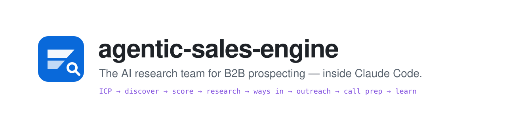
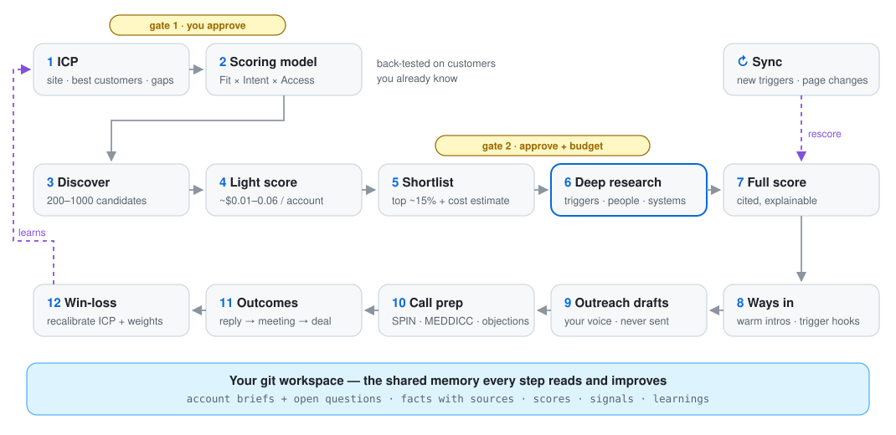

<p align="center">
  <picture>
    <source media="(prefers-color-scheme: dark)" srcset="assets/banner-dark.svg">
    
  </picture>
</p>

<p align="center">
  <a href="https://github.com/heindewilde/agentic-sales-engine/actions/workflows/ci.yml"></a>
  <a href="LICENSE"></a>
  <a href="https://claude.com/claude-code"></a>
  
  
</p>

<p align="center">
  <b>Tell it who you sell to. It finds the companies, researches them like a good SDR would,<br>
  scores them with cited evidence, finds a way in, drafts the first message and preps the call.</b>
</p>

<p align="center">
  <a href="#quickstart">Quickstart</a> ·
  <a href="#see-it-work">See it work</a> ·
  <a href="#how-it-works">How it works</a> ·
  <a href="#autopilot">Autopilot</a> ·
  <a href="#quality-you-can-measure">Quality</a> ·
  <a href="#what-it-costs">What it costs</a> ·
  <a href="#how-it-compares">How it compares</a> ·
  <a href="#faq">FAQ</a>
</p>

<!--
  Demo GIF slot. Record one with `vhs docs/demo.tape` (https://github.com/charmbracelet/vhs) and uncomment:
  <p align="center"></p>
-->

---

## Why

Good prospecting is research: who fits, what changed for them recently, who decides, and what you could say that
isn't generic. Doing that properly takes an hour per account, so most teams don't. They buy a list, blast a sequence,
and learn nothing.

**agentic-sales-engine** is a [Claude Code](https://claude.com/claude-code) plugin that does the research part
autonomously and hands each step's findings to the next one:

- **Research-first.** It reads company sites, job ads, news and registries, maps the buying committee to your personas, and keeps a running brief per account with the questions still open.
- **Evidence or nothing.** Every fact has a source, date and confidence. A write hook *rejects* unsourced claims. Unknowns stay unknown instead of being guessed.
- **Explainable scores.** Your own Fit × Intent × Access rubric, back-tested against customers you already know. Every point in a score links to a quote.
- **You stay in charge.** You approve the ICP and the shortlist (with a cost estimate) before money is spent on deep research. Nothing is ever sent for you.
- **It checks its own work.** A built-in eval suite measures whether claims match their sources, handoffs are complete and drafts follow the rules. Every step can be traced with OpenTelemetry.
- **It learns.** Outcomes flow back into win-loss reviews and score recalibration.
- **Your data stays yours.** Everything lives in a git repository of plain markdown that your team can read, edit, review and diff. No SaaS database.

## Quickstart

You need [Claude Code](https://claude.com/claude-code) and [Bun](https://bun.sh) ≥ 1.3.

```text
/plugin install agentic-sales-engine --marketplace heindewilde/agentic-sales-engine
```

Then open Claude Code in an empty folder and run:

```text
/agentic-sales-engine:setup          # creates your workspace (its own git repo) and checks your setup
/agentic-sales-engine:icp-build      # reads your website, learns from your best customers, asks only what's missing
```

From there `/agentic-sales-engine:status` always tells you the next step. Or let it run hands-off:

```text
/agentic-sales-engine:autopilot start --icp <your-icp> --budget 50
```

Autopilot discovers, scores, researches, finds ways in and drafts on its own. It pauses only for you to approve the
shortlist and review the drafts, and it stays within one budget.

<details>
<summary><b>Provider keys</b> (optional, but recommended)</summary>

The engine works without any keys, using Claude Code's built-in web search plus CSV lists you import. With keys it gets
much better at finding companies and people:

| Provider | Used for | Free tier |
|---|---|---|
| [Exa](https://exa.ai) | company & people discovery, dated news, deep research agent | $10/month credit |
| [Firecrawl](https://firecrawl.dev) | reading and extracting structured data from company websites | 1,000 credits/month · self-hostable |

Enter them via `/plugin` → **agentic-sales-engine** → configure. They're stored in your OS keychain, never in files.
For headless batch runs on your machine, store them once with
`pbpaste | bun <plugin>/src/cli/ase.ts keys set EXA_API_KEY`. For Firecrawl, run
`npx firecrawl-cli login --browser` followed by `ase keys pull-firecrawl`.
</details>

## See it work

A walkthrough with a fictional company: **Ledgerly**, which sells accounts-payable automation to mid-market companies in
the Benelux and DACH. The excerpts below follow the engine's real file formats. The companies and people are invented.

**1 · ICP.** `icp-build` reads Ledgerly's website and its ten best (and five worst) customers, then asks three
questions it couldn't answer (deal size, who signs, why deals are lost). It drafts *"Mid-market companies drowning in
supplier invoices"*: wholesale, manufacturing and logistics, 100–1,000 staff, a mid-market ERP, no AP tooling, with
triggers like a new CFO or an acquisition. You approve it (**gate 1**).

**2 · Scoring model.** `scoring-design` proposes eight factors with anchored 0–3 levels and back-tests them on the
customers you named.

```text
# summary of `ase score backtest` + `ase score sensitivity`
Back-test v1:  AUC 1.00 · median good customer outranks 92% of the field
               verdict: pass
Sensitivity:   finance_change and industry_fit carry the ranking;
               warm_path is weak but kept (access)
```

**3 · Discover and light-score.** `discover` runs the ICP's queries per country and saves 300+ deduplicated candidates
(your customers and competitors are excluded automatically). `enrich-light` gives each a cited snapshot and a cheap
score, in batches of headless sessions. `shortlist` proposes the top 15% with a cost estimate, and you approve it
(**gate 2**).

**4 · Deep research.** For each shortlisted account a research agent works through the brief's open questions:

<details>
<summary><b>Account brief</b> — <code>accounts/maasverhoeven.example/brief.md</code> (excerpt)</summary>

```markdown
## Snapshot
Maas & Verhoeven Foodservice is a family-owned B2B food wholesaler in Ghent supplying ~6,000 restaurants and
independent retailers from three depots; ~310 employees.[^1][^2]

## Situation & triggers
- 2026-07-01 — acquired Delcourt Traiteur (Liège), its 9th acquisition since 2015.[^3]
- 2026-09-10 — launched "Buurtmarkt", a convenience format for independent shops, with a national retailer (10 → 100 stores).[^4]
- Careers page: 14 open roles in logistics and sales, none in finance or AP.[^5]

## Open questions
- [x] Is supplier invoice volume high? → ~1,200 active suppliers per the 2025 annual report.[^6]
- [ ] Which ERP runs AP after the Delcourt acquisition? (unknown after research; owner: call-prep)
- [ ] Is there already an OCR/AP tool in use? (unknown after research; owner: call-prep)

[^3]: Gondola Foodservice, https://news.example/maas-verhoeven-acquires-delcourt (2026-07-01)
```
</details>

<details>
<summary><b>Score breakdown</b> — light 75 (A) → full 62 (B), upside 86</summary>

| Factor | Group | Level | Evidence |
|---|---|---|---|
| Headcount in range | fit | 3 — 150–700 | "approximately 310 employees" (registry.example) |
| Invoice-heavy industry | fit | 3 — wholesale / distribution | "B2B food wholesaler" (maasverhoeven.example/about) |
| Compatible mid-market ERP | fit | unknown | — no source found (caps the score; listed as open question) |
| Finance or system change | intent | 3 — change in last 6 months | "acquired Delcourt Traiteur" (news.example, 2026-07-01) |
| Hiring AP clerks | intent | 0 — no | "14 open roles … logistics and sales" (careers page) |
| Warm path to a persona | access | 0 — no connections | team warm-matches.yaml |

*Unknown is not zero:* the ERP factor uses a conservative prior, and the **upside** shows what the account could score
if research confirms it. `score --explain` turns this into plain language.
</details>

**5 · Ways in, outreach, call prep.**

<details>
<summary><b>LinkedIn connection note</b> — drafted, never sent</summary>

```markdown
Hi Sofie, congrats on the Delcourt acquisition, the ninth one if I count right.[^1] Bringing another entity's suppliers
into one AP process is usually where the fun starts. I work on that problem for wholesalers and would enjoy
comparing notes. Happy to connect.

[^1]: Gondola Foodservice, https://news.example/maas-verhoeven-acquires-delcourt (2026-07-01)
```

Your edits to drafts are kept next to the originals, and `voice-profile --learn` turns them into style rules.
</details>

<details>
<summary><b>Call prep</b> — <code>callprep/2026-10-22.md</code> (excerpt)</summary>

```markdown
## 4. Discovery questions (SPIN)
Situation  1. Which ERP(s) does AP run on today — the same for Maas & Verhoeven and Delcourt?
Problem    3. How do supplier invoices reach AP per entity (paper, PDF, EDI), and how many per month?
Implication 6. When invoices slip, what happens to supplier terms and the month-end close?
Need-payoff 8. If invoices were captured and routed automatically across entities, what would your team do with that time?

## 5. Qualification gaps (MEDDICC)
| Metrics        | unknown — no invoice volumes yet            | invoices/month per entity, AP FTEs        |
| Economic buyer | Sofie Claes, Finance Director (to confirm)  | who signs a €18–40k contract              |
| Champion       | candidate: supplier-accounting lead         | will they sponsor a pilot?                |
```
</details>

**6 · Learn.** You mark drafts as sent. Silence counts as *no response* after 21 days, and a weekly
`review-outcomes` asks one multiple-choice question per open account. Once enough outcomes exist, `win-loss` shows
which tiers, triggers and channels actually convert, with honest error bars, and proposes rubric and weight changes for
you to approve.

## How it works

<p align="center">
  <picture>
    <source media="(prefers-color-scheme: dark)" srcset="assets/pipeline-dark.svg">
    
  </picture>
</p>

**Wide, then deep.** Cheap passes over hundreds of companies; expensive research only on the shortlist you approve.

**Handoffs, not prompts.** Every account has a `brief.md` with fixed sections. Its **Open questions** are the next
stage's research agenda, and each stage leaves the brief better than it found it. A stage can only mark an account as
done when its *handoff contract* holds: the files the next stage relies on exist and validate.

**A knowledge base you can trust.** One markdown file per company, person and signal, with every structured fact
stored as `{value, source_url, retrieved_at, confidence}`. Claude Code hooks guard every write: unsourced facts,
do-not-contact entities, non-business personal data and edits to source snapshots are rejected before they land.
A SQLite index is rebuilt from the files for fast queries. Facts expire, and `refresh` and `sync` keep them current.

**Deterministic where it matters.** Anything that must be exactly right is code with tests (≈130), not prompt
instructions: score maths, back-tests, budgets, deduplication, privacy rules and stage contracts. The LLM does what it's
good at: reading, judging against a rubric, and writing.

<details>
<summary><b>What's in a workspace</b></summary>

```text
my-sales-workspace/
├── ase.config.yaml            team, budgets, privacy mode, models, providers
├── company/                   who you are: profile, materials, voice
├── icps/<slug>/               ICP, scoring.yaml (versioned), calibration, win-loss reviews
├── accounts/<domain>/         company.md · brief.md · scores/ · signals/ · drafts/ · callprep/
├── people/<id>.md             business-relevant data only, with lawful basis
├── outcomes/events.jsonl      sent → reply → meeting → deal, with reason codes
├── raw/                       immutable source snapshots every fact can point to
├── learnings/                 corrections and preferences every skill reads
├── dnc.yaml                   do-not-contact list, enforced everywhere
└── ledger/costs.jsonl         every paid call, estimated before and recorded after
```
</details>

## Autopilot

Run the whole funnel for an ICP with one command. It works through every step on its own, stops only where a human
should decide, and stays within the budget you give it.

```text
/agentic-sales-engine:autopilot start --icp ap-automation-midmarket --budget 50
```

This is the actual status from a live run on real Benelux wholesalers (started with `--until shortlist`, so the later
steps were skipped):

```text
autopilot 20261015-145833-autopilot · ap-automation-midmarket · waiting · spent $0.59 of $2
  ✓ discover      25 new candidates  ($0.26)
  ✓ enrich_light  25/25 light-scored  ($0.33)
  ⏸ shortlist     proposed 6 of 25 (≈ $3–6)
  – research
  – score
  – ways_in
  – drafts

GATE 2: review lists/ap-automation-midmarket/20261015-150146-shortlist/shortlist.md
        (6 accounts, ≈ $3–6) and approve: ase autopilot approve --by <member>
```

- **Two gates, never skipped.** It waits for you to approve the shortlist (with its cost estimate) before deep research,
  and to review the drafts at the end. Untick accounts in the shortlist file to leave them out.
- **Resumable.** Progress is checkpointed after every step; the account files remain the source of truth. After a crash, a
  gate or a budget stop, `resume` continues where it left off without repeating finished work.
- **One budget.** Every model and data call counts against it. When it runs out, the run waits for you to raise it
  instead of failing.
- **Retries, not surprises.** A step whose sessions crash is retried with backoff and only re-processes the accounts
  that didn't advance. Accounts a session couldn't move forward are listed, not hidden.

`/agentic-sales-engine:status` shows a waiting or failed run at the top, and the skill walks you through each gate.

## Quality you can measure

AI research is only useful if you can trust it, so the engine checks its own output. Results come back as
`{ key, score, comment }` (the OpenEvals convention), are saved per run in your workspace, and are compared with the
previous run. A drop of more than 0.05 is flagged as a regression.

| Evaluator | What it catches | Cost |
|---|---|---|
| `citation_faithfulness` | a scored quote that isn't actually in the source it cites | free |
| `brief_grounding` | statements in a brief without a source (reported absences are fine) | free |
| `snapshot_coverage` | cited pages that were never saved, so nobody can verify them later | free |
| `handoff_completeness` | a stage marked done while the next stage lacks what it needs | free |
| `draft_rules` | drafts that are too long, uncited, clichéd, or contain numbers not in the sources | free |
| `research_trajectory` | the expensive research agent used before cheap lookups | free |
| `claim_support` | Claude judges each statement against all of its cited sources | ~$0.05 per account |
| `judge_stability` | re-scoring the same evidence gives different factor levels | ~$0.05 per account |
| `draft_quality` | drafts that aren't specific, relevant, grounded or clear in their ask | ~$0.03 per draft |

```text
ase eval run --text                                    # free checks, seconds
ase eval run --suite llm --budget 1 --sample 3 --text  # Claude as judge, on your Claude login
```

The free checks also run in CI on a fully researched fictional account, so a change to the engine that weakens sourcing
or draft hygiene fails the build. On a real research run, the paid suite found facts cited to pages that didn't contain
them, two rubric factors whose wording gets re-judged differently, and a draft with an unbacked claim and a vague ask.
Each came with the fix to make. Details in [docs/evals.md](docs/evals.md).

## See every step

Set one environment variable and every run becomes a trace you can open in Langfuse, LangSmith, Phoenix, Jaeger or any
OpenTelemetry backend:

```text
autopilot.run                        [autopilot]  budget · status · spent
└─ autopilot.step.enrich_light
   └─ batch.run                      [batch]      skill · accounts · advanced
      └─ batch.chunk                              model · tokens · cost
         ├─ tool.fetch_pages  2.8s   [session]
         ├─ provider.fetch_pages     [gateway]    firecrawl · $0.004
         ├─ tool.Edit  error         [session]    rejected or failed edit
         └─ score.compute            [cli]        53.6 · tier B
```

The labels in brackets are separate processes (the autopilot, batch driver, headless Claude session, provider gateway and
CLI), yet they show up as one connected trace. That makes "why did this account score low?" and "where did the money go?" one click each. Spans
carry metadata only (operations, domains, costs, durations, outcomes) unless you explicitly turn on content capture.
Setup per backend in [docs/tracing.md](docs/tracing.md).

## What it costs

Measured on real runs with live Exa and Firecrawl calls and real Claude sessions (API-equivalent model cost). Your
numbers will vary with list size, model choice and how much research an account needs.

| Step | Typical cost | Of which data providers |
|---|---|---|
| Discovery | ~$0.002 per candidate company | Exa search |
| Light enrichment + score (Haiku, batched) | $0.01–0.06 per account (≈ $0.013 in a 25-account run) | ≈ $0–0.01 |
| Deep research + full score (Sonnet) | $0.30–0.90 per account | $0.02–0.06 |
| Ways in · outreach draft · call prep | ~$0.30 · ~$0.30 · ~$0.40 per account | ~$0.01 |
| Monitoring (`sync`) | ~$0.02 per watched account per check | Exa + Firecrawl |
| Quality evals | free offline · ~$0.05 per account with Claude as judge | — |
| **Real example:** autopilot, 25 companies discovered and light-scored, shortlist proposed | **$0.59 in total** | $0.09 |

**A full cycle of 300 discovered and 45 deep-researched accounts comes to roughly $20–60, most of it deep research.** Every run has a budget:
the engine estimates the cost before deep research, enforces per-run and per-day caps before each paid call, and logs
every dollar to `ledger/costs.jsonl`.

## How it compares

|  | agentic-sales-engine | Data-platform tools<br><sub>(e.g. Clay)</sub> | Contact databases<br><sub>(e.g. Apollo)</sub> | Chatting with an AI<br><sub>(one-off research)</sub> |
|---|---|---|---|---|
| Deep research per account | ✅ agent works the open questions | ◐ AI columns per field | ◐ firmographic data | ✅ but one account at a time |
| Every fact cited and dated | ✅ enforced on write | ◐ depends on the column | ✗ | ◐ in the answer |
| Explainable, back-tested scoring | ✅ your rubric, evidence per point | ◐ formula columns | ◐ score fields | ✗ |
| Memory across steps and runs | ✅ briefs + open questions | ◐ the table | ✅ records | ✗ |
| Learns from outcomes | ✅ win-loss + recalibration | ✗ | ◐ | ✗ |
| Checks its own output quality | ✅ eval suite, in CI and on real output | ✗ | ✗ | ✗ |
| Step-by-step traces of what it did | ✅ OpenTelemetry, any backend | ◐ run history | ✗ | ✗ |
| Runs end to end on its own | ✅ autopilot, pauses at your gates | ◐ table automations | ◐ sequences | ✗ |
| Contact data (emails, phones) at scale | ◐ people search; bring your own | ✅ waterfall enrichment | ✅ large database | ✗ |
| Sends sequences | ✗ by design: drafts only | ✅ via integrations | ✅ | ✗ |
| Your data | ✅ plain files in your git repo | their platform | their platform | chat history |
| Customizable | ✅ MIT; methodology is markdown, scoring is YAML | ◐ workflows | ◐ settings | ◐ prompts |
| Pricing | pay per use (see above) | subscription + credits | per seat | subscription |

It's not a contact database or a sending tool. It pairs well with one: import their lists as seeds, and send from
whatever you already use.

## All commands

<details>
<summary>25 skills, all invoked as <code>/agentic-sales-engine:&lt;name&gt;</code></summary>

| Stage | Skill | What it does |
|---|---|---|
| Start | `setup` | Create or check a workspace |
|  | `autopilot` | Run the whole funnel hands-off, pausing at your gates, within one budget |
|  | `status` | Funnel, gates, spend, outcomes and the next action |
| Define | `icp-build` | ICP from your site, materials and best customers; market-size check; **gate 1** |
|  | `scoring-design` | Fit × Intent × Access rubric, back-test, sensitivity, versioning |
| Funnel | `import` | Seed lists (Apollo, Sales Navigator, trade fairs) or a LinkedIn connections export |
|  | `discover` | Find companies matching the ICP, deduplicated, DNC-filtered |
|  | `enrich-light` | Cited snapshot + light score per account (batched) |
|  | `shortlist` | Proposal with cost estimate; **gate 2** |
|  | `research` | Deep research: triggers, buying committee, systems, risks → full score |
|  | `score` | Re-score; `--explain` says what drives a score |
| Engage | `ways-in` | Rank warm intros and trigger hooks |
|  | `voice-profile` | Learn your writing voice from samples and from your edits |
|  | `draft-outreach` | Email, LinkedIn or intro-request drafts, grounded and cited, never sent |
|  | `call-prep` | One page: why now, attendees, SPIN questions, MEDDICC gaps, objections |
| Stay current | `sync` | Watch accounts for new triggers and page changes ([schedule it](docs/scheduling.md)) |
|  | `refresh` | Re-verify facts past their TTL |
| Learn | `log-outcome` | Replies, meetings, deals, wins, losses, with reason codes |
|  | `review-outcomes` | Weekly pass: one multiple-choice question per open account |
|  | `win-loss` | What converts, with error bars; proposed ICP, rubric and weight changes |
|  | `learn` | Teach a correction or preference every skill will follow |
| Quality | `evals` | Measure the engine's own output: sourcing, claim support, handoffs, drafts, judge stability |
| Hygiene | `lint` | Unsourced, stale, duplicate or contradictory knowledge |
|  | `dnc` | Do-not-contact list |
|  | `forget-person` | GDPR erasure across files, matches and snapshots |
</details>

## FAQ

<details>
<summary><b>Does it send emails or LinkedIn messages?</b></summary>

No, by design. It writes drafts you edit and send yourself. When you mark a draft as sent, outcome tracking starts.
</details>

<details>
<summary><b>Does it scrape LinkedIn?</b></summary>

No. People come from Exa's professional-profile index, public company pages, and your team's own LinkedIn connections
export. That export stays on your machine; only matches against tracked accounts are committed.
</details>

<details>
<summary><b>What about GDPR?</b></summary>

Privacy mode is on by default. Only business-relevant personal data is stored, personal mailboxes and special-category
data are rejected by the write hook, every person carries a lawful basis, `forget-person` erases someone everywhere,
and the do-not-contact list is enforced in every step. A legitimate-interest assessment template ships with each
workspace. This isn't legal advice: have your DPO look at it.
</details>

<details>
<summary><b>Do I need API keys?</b></summary>

No. Without keys it uses Claude Code's built-in web search and the lists you import. With Exa (and ideally Firecrawl)
discovery, people search and site extraction are much better, and both have free tiers.
</details>

<details>
<summary><b>Which models does it use?</b></summary>

Claude. By default Haiku for wide, cheap passes and Sonnet for research and judging, configurable per stage in
`ase.config.yaml`. Interactive use runs on your Claude Code plan. Batch runs use the Claude Agent SDK.
</details>

<details>
<summary><b>Can it run unattended?</b></summary>

Yes. `autopilot` runs the whole funnel, and `batch.ts` and scheduled `sync` runs work headless too (see
[docs/scheduling.md](docs/scheduling.md)). Unattended runs never pass a human gate, never send anything, and stop at
their budget.
</details>

<details>
<summary><b>How do I know the research is any good?</b></summary>

Measure it: `ase eval run`. The free checks verify that scored quotes are really in their sources, brief statements are
sourced and handoffs are complete. The Claude-as-judge checks verify that statements are supported by what they cite and
that scoring is stable. Results are saved per run, so you can see whether quality goes up or down when you change a
rubric or a skill.
</details>

<details>
<summary><b>Can I see exactly what it did, and what each step cost?</b></summary>

Yes, in two ways. Every paid call is logged in `ledger/costs.jsonl` (`ase ledger report`). With OpenTelemetry enabled,
each run is a trace you can open in Langfuse, LangSmith, Phoenix or Jaeger, showing every tool call, provider call, cost
and score ([docs/tracing.md](docs/tracing.md)).
</details>

<details>
<summary><b>How is this different from asking Claude to research a company?</b></summary>

That's one good answer that's gone tomorrow. Here, research is persistent (briefs, sourced facts, open questions),
comparable (one rubric across hundreds of accounts), gated (you approve what gets researched and what it costs),
repeatable (autopilot, batches, monitoring), measurable (evals, traces) and self-improving (outcomes feed back into
the ICP and the scoring).
</details>

<details>
<summary><b>Can my team use it together?</b></summary>

Yes. The workspace is a git repo: commit, pull, review changes like code. Each member imports their own LinkedIn
connections for warm paths, approvals record who approved, and the logs merge cleanly.
</details>

<details>
<summary><b>Can I change how it thinks?</b></summary>

That's the point of it being open source. The sales methodology lives in [`methodology/`](methodology/) as markdown,
your scoring rubric is a YAML file you own, and every stage is a skill file you can fork.
</details>

## Development

```bash
bun install
bun test                         # ~130 offline tests (unit, hooks, CLI, autopilot, evals, simulated learning loop)
bun src/cli/ase.ts eval run --workspace fixtures/workspace-ledgerly --min 1   # the CI quality gate
ASE_LIVE=1 bun test tests/live   # real Exa/Firecrawl calls (~$0.05)
bun run typecheck
claude plugin validate .
claude --plugin-dir .            # run the plugin from a checkout, inside a workspace folder
```

More: [architecture](docs/architecture.md) · [quality evals](docs/evals.md) · [tracing (OpenTelemetry)](docs/tracing.md) · [scheduling](docs/scheduling.md).
Contributions are welcome: see [CONTRIBUTING.md](CONTRIBUTING.md).

## License

[MIT](LICENSE) © Hein de Wilde
