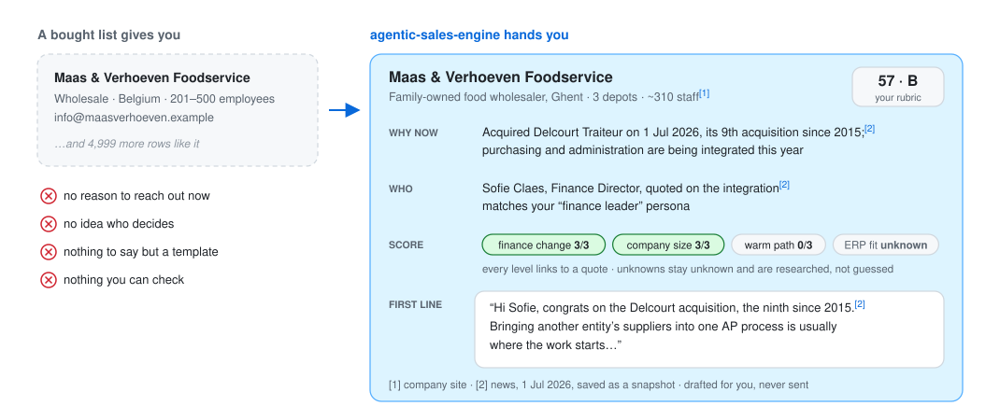
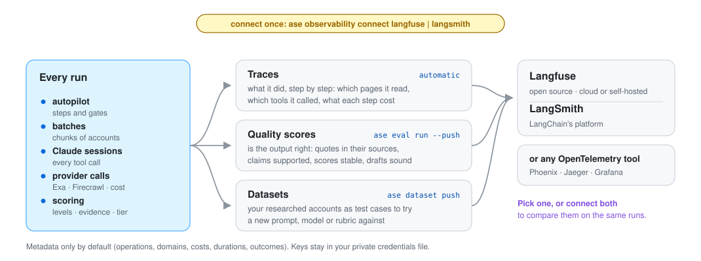
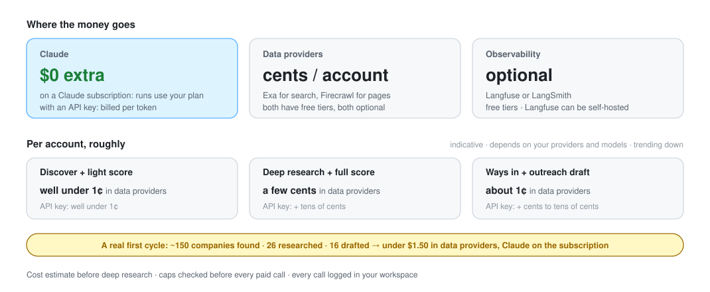
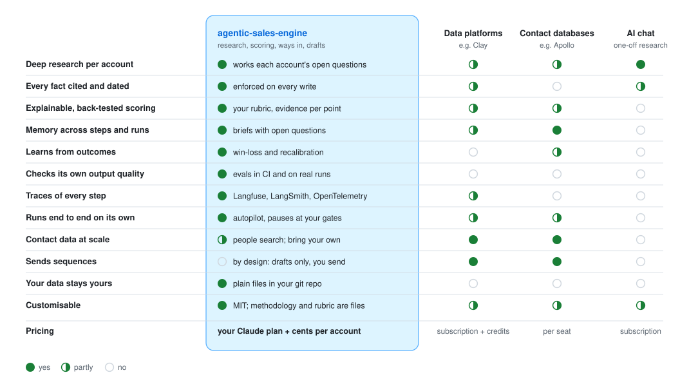

<p align="center">
  <picture>
    <source media="(prefers-color-scheme: dark)" srcset="assets/banner-dark.svg">
    
  </picture>
</p>

<p align="center">
  <a href="https://github.com/heindewilde/agentic-sales-engine/actions/workflows/ci.yml"></a>
  <a href="LICENSE"></a>
  <a href="https://claude.com/claude-code"></a>
  
  
</p>

<p align="center">
  <b>Tell it who you sell to. It finds the companies, researches them like a good SDR would,<br>
  scores them with cited evidence, finds a way in, drafts the first message and preps the call.</b>
</p>

<p align="center">
  <a href="#quickstart">Quickstart</a> ·
  <a href="#how-it-works">How it works</a> ·
  <a href="#autopilot">Autopilot</a> ·
  <a href="#quality-and-observability">Quality & observability</a> ·
  <a href="#what-it-costs">What it costs</a> ·
  <a href="#how-it-compares">How it compares</a> ·
  <a href="#faq">FAQ</a>
</p>

<!--
  Demo GIF slot. Record one with `vhs docs/demo.tape` (https://github.com/charmbracelet/vhs) and uncomment:
  <p align="center"></p>
-->

---

## Why

Outbound works when it's specific: the right company, at the right moment, with something to say that is about
*them*. That takes about an hour of research per account, so most teams skip it and send templates to bought lists.
**agentic-sales-engine does that hour for every account, on its own, and shows its sources.**

<p align="center">
  <picture>
    <source media="(prefers-color-scheme: dark)" srcset="assets/why-dark.svg">
    
  </picture>
</p>

- **Every line is checkable.** Facts carry a source and a date, and a write hook rejects anything unsourced. What
  isn't known stays unknown.
- **Scored on your rubric.** Fit, intent and access, back-tested on the customers you already have, with the evidence
  behind every point.
- **You make the calls.** You approve the ICP, the shortlist and the scores. It drafts; you send.
- **It's yours.** Plain markdown in your own git repo, running in Claude Code on your Claude subscription.

## Quickstart

You need [Claude Code](https://claude.com/claude-code) and [Bun](https://bun.sh) ≥ 1.3.

```text
/plugin install agentic-sales-engine --marketplace heindewilde/agentic-sales-engine
```

Then open Claude Code in an empty folder and run:

```text
/agentic-sales-engine:setup       # creates your workspace (its own git repo)
/agentic-sales-engine:icp-build   # learns from your site and best customers, asks what's missing
```

From there `/agentic-sales-engine:status` always tells you the next step. Or let it run hands-off:

```text
/agentic-sales-engine:autopilot start --icp <your-icp>
```

Autopilot discovers, scores, researches, finds ways in and drafts on its own. It pauses only for your decisions:
approving the shortlist, reviewing the scores and reviewing the drafts. On a Claude subscription that's all; with an
API key, add `--budget <usd>` to cap what it spends.

<details>
<summary><b>Provider keys</b> (optional, but recommended)</summary>

The engine works without any keys, using Claude Code's built-in web search plus CSV lists you import. With keys it gets
much better at finding companies and people:

| Provider | Used for | Free tier |
|---|---|---|
| [Exa](https://exa.ai) | company & people discovery, dated news, deep research agent | $10/month credit |
| [Firecrawl](https://firecrawl.dev) | reading and extracting structured data from company websites | 1,000 credits/month · self-hostable |

Enter them via `/plugin` → **agentic-sales-engine** → configure. They're stored in your OS keychain, never in files.
For headless batch runs on your machine, store them once with
`pbpaste | bun <plugin>/src/cli/ase.ts keys set EXA_API_KEY`. For Firecrawl, run
`npx firecrawl-cli login --browser` followed by `ase keys pull-firecrawl`.
</details>

## How it works

<p align="center">
  <picture>
    <source media="(prefers-color-scheme: dark)" srcset="assets/pipeline-dark.svg">
    
  </picture>
</p>

**Wide, then deep.** Quick passes over hundreds of companies; deep research only on the shortlist you approve, and
outreach work only on the accounts whose scores you've reviewed.

**Handoffs, not prompts.** Every account has a `brief.md` with fixed sections. Its **Open questions** are the next
stage's research agenda, and each stage leaves the brief better than it found it. A stage can only mark an account as
done when its *handoff contract* holds: the files the next stage relies on exist and validate.

**A knowledge base you can trust.** One markdown file per company, person and signal, with every structured fact
stored as `{value, source_url, retrieved_at, confidence}`. Claude Code hooks guard every write: unsourced facts,
do-not-contact entities, non-business personal data and edits to source snapshots are rejected before they land.
A SQLite index is rebuilt from the files for fast queries. Facts expire, and `refresh` and `sync` keep them current.

**Deterministic where it matters.** Anything that must be exactly right is code with tests (160+), not prompt
instructions: score maths, back-tests, budgets, deduplication, privacy rules and stage contracts. The LLM does what it's
good at: reading, judging against a rubric, and writing.

<details>
<summary><b>What's in a workspace</b></summary>

```text
my-sales-workspace/
├── ase.config.yaml            team, budgets, privacy mode, models, providers
├── company/                   who you are: profile, materials, voice
├── icps/<slug>/               ICP, scoring.yaml (versioned), calibration, win-loss
├── accounts/<domain>/         company · brief · scores · signals · drafts · callprep
├── people/<id>.md             business-relevant data only, with lawful basis
├── outcomes/events.jsonl      sent → reply → meeting → deal, with reason codes
├── raw/                       immutable source snapshots every fact can point to
├── learnings/                 corrections and preferences every skill reads
├── dnc.yaml                   do-not-contact list, enforced everywhere
└── ledger/costs.jsonl         every paid call, estimated before and recorded after
```
</details>

## Autopilot

Run the whole funnel for an ICP with one command. It works through every step on its own and stops only where a
person should decide:

```text
/agentic-sales-engine:autopilot start --icp <your-icp>
```

- **Three decisions stay yours:** which accounts get deep research (gate 2), which scored accounts are worth
  approaching (gate 3), and the drafts you edit and send.
- **Leave it running.** It picks up where it left off after an interruption, waits out a Claude usage limit, and
  `/agentic-sales-engine:status` always shows where a run is and what it needs from you.

## Quality and observability

Once the engine runs on its own, you want to know two things: **is the output right, and what exactly did it do?**
Connect [Langfuse](https://langfuse.com) or [LangSmith](https://smith.langchain.com), or both to compare them, and
every run reports there.

<p align="center">
  <picture>
    <source media="(prefers-color-scheme: dark)" srcset="assets/observability-dark.svg">
    
  </picture>
</p>

- **Traces** show each run step by step: which pages were read, which tools were called, what every step cost and
  how long it took. Why did this account score low? Open its trace.
- **Quality scores** say whether the output can be trusted: are quotes really in their sources, are claims supported,
  does re-scoring give the same result, are drafts specific and grounded. Each finding comes with the fix.
- **Datasets** turn your researched accounts into test cases, so a new prompt, model or rubric is judged on the same
  accounts as the last one.

Connecting takes one command (`pbpaste | ase observability connect langfuse`, or `langsmith`); keys are read from the
clipboard and stored privately. Setup and details: [docs/observability.md](docs/observability.md) ·
[docs/evals.md](docs/evals.md).

## What it costs

On a Claude subscription the AI part costs nothing extra: every session, including batch and autopilot runs, runs
through Claude Code on your login and counts toward your plan's usage. What you pay for is data, at cents per account.

<p align="center">
  <picture>
    <source media="(prefers-color-scheme: dark)" srcset="assets/costs-dark.svg">
    
  </picture>
</p>

Figures are indicative and measured on real runs; they depend on the providers and models you choose. With an API
key, Claude is billed per token and becomes most of the cost, mainly deep research. Budgets per run and per day then
cover Claude too; on a subscription they only cap the data providers and the engine won't ask for one.
`ase ledger report` shows what every run cost, and [bench/](bench/) measures cost and quality together.

## How it compares

<p align="center">
  <picture>
    <source media="(prefers-color-scheme: dark)" srcset="assets/compare-dark.svg">
    
  </picture>
</p>

It's not a contact database or a sending tool. It pairs well with one: import their lists as seeds, and send from
whatever you already use.

## All commands

<details>
<summary>25 skills, all invoked as <code>/agentic-sales-engine:&lt;name&gt;</code></summary>

| Stage | Skill | What it does |
|---|---|---|
| Start | `setup` | Create or check a workspace |
|  | `autopilot` | Run the whole funnel hands-off, pausing at your three gates and the draft review |
|  | `status` | Funnel, gates, spend, outcomes and the next action |
| Define | `icp-build` | ICP from your site, materials and best customers; market-size check; **gate 1** |
|  | `scoring-design` | Fit × Intent × Access rubric, back-test, sensitivity, versioning |
| Funnel | `import` | Seed lists (Apollo, Sales Navigator, trade fairs) or a LinkedIn connections export |
|  | `discover` | Find companies matching the ICP, deduplicated, DNC-filtered |
|  | `enrich-light` | Cited snapshot + light score per account (batched) |
|  | `shortlist` | Proposal with cost estimate; **gate 2** |
|  | `research` | Deep research: triggers, buying committee, systems, risks → full score |
|  | `score` | Re-score; `--explain` says what drives a score; **gate 3** (review before engaging) |
| Engage | `ways-in` | Rank warm intros and trigger hooks |
|  | `voice-profile` | Learn your writing voice from samples and from your edits |
|  | `draft-outreach` | Email, LinkedIn or intro-request drafts, grounded and cited, never sent |
|  | `call-prep` | One page: why now, attendees, SPIN questions, MEDDICC gaps, objections |
| Stay current | `sync` | Watch accounts for new triggers and page changes ([schedule it](docs/scheduling.md)) |
|  | `refresh` | Re-verify facts past their TTL |
| Learn | `log-outcome` | Replies, meetings, deals, wins, losses, with reason codes |
|  | `review-outcomes` | Weekly pass: one multiple-choice question per open account |
|  | `win-loss` | What converts, with error bars; proposed ICP, rubric and weight changes |
|  | `learn` | Teach a correction or preference every skill will follow |
| Quality | `evals` | Measure the engine's own output: sourcing, claim support, handoffs, drafts, judge stability |
| Hygiene | `lint` | Unsourced, stale, duplicate or contradictory knowledge |
|  | `dnc` | Do-not-contact list |
|  | `forget-person` | GDPR erasure across files, matches and snapshots |
</details>

## FAQ

<details>
<summary><b>Does it send emails or LinkedIn messages?</b></summary>

No, by design. It writes drafts you edit and send yourself. When you mark a draft as sent, outcome tracking starts.
</details>

<details>
<summary><b>Does it scrape LinkedIn?</b></summary>

No. People come from Exa's professional-profile index, public company pages, and your team's own LinkedIn connections
export. That export stays on your machine; only matches against tracked accounts are committed.
</details>

<details>
<summary><b>What about GDPR?</b></summary>

Privacy mode is on by default. Only business-relevant personal data is stored, personal mailboxes and special-category
data are rejected by the write hook, every person carries a lawful basis, `forget-person` erases someone everywhere,
and the do-not-contact list is enforced in every step. A legitimate-interest assessment template ships with each
workspace. This isn't legal advice: have your DPO look at it.
</details>

<details>
<summary><b>Do I need API keys?</b></summary>

No. Claude runs on your Claude Code login, so no Anthropic API key is needed. Without data-provider keys it uses
Claude Code's built-in web search and the lists you import. With Exa (and ideally Firecrawl), discovery, people search
and site extraction are much better, and both have free tiers.
</details>

<details>
<summary><b>Which models does it use?</b></summary>

Claude. By default Haiku for wide, cheap passes and Sonnet for research and judging, configurable per stage in
`ase.config.yaml`. Everything runs on whatever Claude Code is logged in with. On a subscription, batch and autopilot
sessions run through Claude Code's own headless mode (`claude -p`). With an API key they use the Claude Agent SDK
(override with `ASE_HEADLESS=cli|sdk`).
</details>

<details>
<summary><b>Can it run unattended?</b></summary>

Yes. `autopilot` runs the whole funnel, and `batch.ts` and scheduled `sync` runs work headless too (see
[docs/scheduling.md](docs/scheduling.md)). Unattended runs never pass a human gate, never send anything, and stop at
their budget.
</details>

<details>
<summary><b>How do I know the research is any good?</b></summary>

Measure it: `ase eval run`. The free checks verify that scored quotes are really in their sources, brief statements are
sourced and handoffs are complete. The Claude-as-judge checks verify that statements are supported by what they cite and
that scoring is stable. Results are saved per run, so you can see whether quality goes up or down when you change a
rubric or a skill.
</details>

<details>
<summary><b>Can I see exactly what it did, and what each step cost?</b></summary>

Yes. Every paid call is logged in `ledger/costs.jsonl` (`ase ledger report`). Connect Langfuse or LangSmith
(`ase observability connect …`) and each run is a trace showing every tool call, provider call, cost and score
([docs/observability.md](docs/observability.md)).
</details>

<details>
<summary><b>How is this different from asking Claude to research a company?</b></summary>

That's one good answer that's gone tomorrow. Here, research is persistent (briefs, sourced facts, open questions),
comparable (one rubric across hundreds of accounts), gated (you approve what gets researched and who gets approached),
repeatable (autopilot, batches, monitoring), measurable (evals, traces) and self-improving (outcomes feed back into
the ICP and the scoring).
</details>

<details>
<summary><b>Can my team use it together?</b></summary>

Yes. The workspace is a git repo: commit, pull, review changes like code. Each member imports their own LinkedIn
connections for warm paths, approvals record who approved, and the logs merge cleanly.
</details>

<details>
<summary><b>Can I change how it thinks?</b></summary>

That's the point of it being open source. The sales methodology lives in [`methodology/`](methodology/) as markdown,
your scoring rubric is a YAML file you own, and every stage is a skill file you can fork.
</details>

## Development

```bash
bun install
bun test                         # 160+ offline tests, incl. a simulated learning loop
bun src/cli/ase.ts eval run --workspace fixtures/workspace-ledgerly --min 1  # CI gate
ASE_LIVE=1 bun test tests/live   # real Exa/Firecrawl calls (~$0.05)
bun run typecheck
claude plugin validate .
claude --plugin-dir .            # run the plugin from a checkout, inside a workspace folder
```

More: [architecture](docs/architecture.md) · [quality evals](docs/evals.md) · [observability](docs/observability.md) · [tracing](docs/tracing.md) · [scheduling](docs/scheduling.md).
Contributions are welcome: see [CONTRIBUTING.md](CONTRIBUTING.md).

## License

[MIT](LICENSE) © Hein de Wilde
